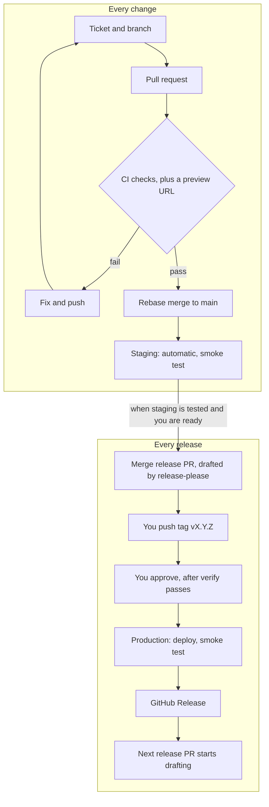

# CI/CD and Release Playbook

A reusable guide to the process PrepNest runs, written so you can apply it to another project.
For PrepNest's own rules, see [release-process.md](release-process.md). Written 2026-11-02.

## Overview

This is a proper release method. It is trunk-based development with tagged releases, gated by CI, staging and a human approval, and it suits a solo developer or a small team.

The rule behind it: **every change reaches `main` through a checked pull request, and only a tag you push, then approve, reaches production.** Examples use GitHub Actions, npm and Cloudflare Workers. The last section lists what to swap for another stack.



The first half runs for every change and needs no decision except the merge. The second half runs for every release and has two deliberate human steps: the tag and the approval.

### How it compares with larger teams

| Practice            | This process                                                      | What larger teams often add                         |
| ------------------- | ----------------------------------------------------------------- | --------------------------------------------------- |
| Code review         | Pull request and automated checks; 0 required approvals when solo | At least 1 required reviewer, `CODEOWNERS` enforced |
| Production approval | Required reviewer; you can approve your own deploy                | Prevent self-review, so a second person approves    |
| Rollout             | All traffic at once, with a smoke test and quick rollback         | Canary or gradual rollout, automatic rollback       |
| Build               | Rebuilt from the tag for each environment                         | One artifact built once, then promoted              |
| After deploy        | Smoke test                                                        | Monitoring, alerts, on-call, error tracking         |
| Supply chain        | Actions pinned to SHAs, Dependabot, CodeQL, secret scanning       | Signed builds, software bill of materials           |

The first two rows change as soon as a second person joins. Add monitoring and alerts before real users depend on the product.

### Status of each part in PrepNest

Staging, previews, tagged production deploys and rollback tooling run in PrepNest today; releases v0.1.0 to v0.2.1 went through them. **release-please has only passed dry runs so far,** because it was still in an open pull request when this was written. Treat that section as tested config, not proven in a full release.

### Files you end up with

| File                                                          | Purpose                                                     |
| ------------------------------------------------------------- | ----------------------------------------------------------- |
| `.github/workflows/ci.yml`                                    | Checks on every pull request and on `main`                  |
| `.github/workflows/pr-title.yml`                              | Enforces Conventional Commits titles                        |
| `.github/workflows/preview.yml`                               | Live preview URL per pull request                           |
| `.github/workflows/deploy-staging.yml`                        | Deploys `main` after CI passes                              |
| `.github/workflows/deploy-production.yml`                     | Tag, approval, deploy, smoke test, GitHub Release           |
| `.github/workflows/release-please.yml`                        | Drafts the release pull request                             |
| `release-please-config.json`, `.release-please-manifest.json` | release-please settings and current version                 |
| `.github/dependabot.yml`                                      | Weekly dependency and Actions updates                       |
| `scripts/smoke-test.ts`                                       | Checks a deployed site really works                         |
| `CHANGELOG.md`, `SECURITY.md`, `.gitattributes`, `.nvmrc`     | Release notes, reporting policy, line endings, Node version |

## Prerequisites

You need Git, the GitHub CLI, your runtime, and a public GitHub repository.

```bash
# Check the tools
git --version
gh --version
node -v

# Log in once
gh auth login

# Create the repository and go into it
gh repo create <owner>/<repo> --public --clone
cd <repo>

# Pin the Node version CI will use
node -v | sed 's/^v//' > .nvmrc

# Same line endings on Windows, macOS and Linux
printf '* text=auto eol=lf\n*.png binary\n*.jpg binary\n*.woff2 binary\n' > .gitattributes
```

**Check your GitHub plan before relying on this on a private repository.** Rulesets and required reviewers on environments are free for public repositories, and are limited on private ones depending on the plan. This is from memory, so confirm it on GitHub's pricing page.

Add the scripts CI calls to `package.json`. Keep the names and change what they run:

```json
{
  "scripts": {
    "lint": "eslint .",
    "format:check": "prettier --check .",
    "typecheck": "tsc --noEmit",
    "test": "vitest run",
    "build": "<your build command>",
    "check": "npm run lint && npm run format:check && npm run typecheck && npm test",
    "smoke": "node scripts/smoke-test.ts"
  }
}
```

## Repository setup

Do this once per repository, before the first feature. The rules apply to you too, because the bypass list is empty.

### 1. Merge settings

Rebase merge only keeps `main` linear and keeps every commit, which release-please reads for the changelog.

```bash
R=<owner>/<repo>
gh api -X PATCH repos/$R -F allow_merge_commit=false -F allow_squash_merge=false \
  -F allow_rebase_merge=true -F delete_branch_on_merge=true \
  -F allow_auto_merge=true -F allow_update_branch=true
```

### 2. Protect `main`

Save as `ruleset-main.json`. The `context` names must match the job `name:` values in your workflows **exactly**. Create this ruleset only after those checks have run once, or no pull request can merge.

```json
{
  "name": "main",
  "target": "branch",
  "enforcement": "active",
  "bypass_actors": [],
  "conditions": { "ref_name": { "include": ["~DEFAULT_BRANCH"], "exclude": [] } },
  "rules": [
    { "type": "deletion" },
    { "type": "non_fast_forward" },
    { "type": "required_linear_history" },
    {
      "type": "pull_request",
      "parameters": {
        "allowed_merge_methods": ["rebase"],
        "required_approving_review_count": 0,
        "required_review_thread_resolution": true,
        "dismiss_stale_reviews_on_push": false,
        "require_code_owner_review": false,
        "require_last_push_approval": false
      }
    },
    {
      "type": "required_status_checks",
      "parameters": {
        "strict_required_status_checks_policy": true,
        "required_status_checks": [
          { "context": "Lint, types, tests, build" },
          { "context": "Conventional Commits title" },
          { "context": "End-to-end tests" },
          { "context": "Lighthouse" }
        ]
      }
    }
  ]
}
```

### 3. Make release tags permanent

A tag that can't move always points at exactly what was released, which makes redeploying an old tag a safe rollback. Save as `ruleset-tags.json`:

```json
{
  "name": "release tags",
  "target": "tag",
  "enforcement": "active",
  "bypass_actors": [],
  "conditions": { "ref_name": { "include": ["refs/tags/v*"], "exclude": [] } },
  "rules": [{ "type": "deletion" }, { "type": "non_fast_forward" }, { "type": "update" }]
}
```

```bash
gh api -X POST repos/$R/rulesets --input ruleset-main.json
gh api -X POST repos/$R/rulesets --input ruleset-tags.json
```

### 4. Security scanning

```bash
gh api -X PUT repos/$R/vulnerability-alerts
gh api -X PUT repos/$R/automated-security-fixes
gh api -X PUT repos/$R/private-vulnerability-reporting
gh api -X PATCH repos/$R \
  -f 'security_and_analysis[secret_scanning][status]=enabled' \
  -f 'security_and_analysis[secret_scanning_push_protection][status]=enabled'
gh api -X PATCH repos/$R/code-scanning/default-setup -f state=configured
```

Push protection blocks a push containing a recognised secret. CodeQL then scans each pull request and `main`, and found a real sanitiser bypass in PrepNest.

### 5. Dependabot

Save as `.github/dependabot.yml`. Grouping gives you fewer, larger pull requests.

```yaml
version: 2
updates:
  - package-ecosystem: npm
    directory: /
    schedule:
      interval: weekly
      day: monday
      time: "06:00"
      timezone: Asia/Kolkata
    open-pull-requests-limit: 5
    commit-message:
      prefix: "chore(deps)"
      prefix-development: "chore(deps-dev)"
    groups:
      production-minor-patch:
        dependency-type: production
        update-types: [minor, patch]
      development-minor-patch:
        dependency-type: development
        update-types: [minor, patch]

  - package-ecosystem: github-actions
    directory: /
    schedule:
      interval: weekly
      day: monday
      time: "06:00"
      timezone: Asia/Kolkata
    commit-message:
      prefix: "ci(deps)"
    groups:
      actions:
        patterns: ["*"]
```

The `chore` prefix keeps dependency updates out of the changelog. Dependabot pull requests get no deploy secrets, so previews skip them by design.

### 6. `SECURITY.md`

Add a short file saying how to report a vulnerability privately. Point people to **Security → Report a vulnerability** rather than a public issue.

## Environments and secrets

Four environments separate your work from your users, and secrets live per environment so a job only receives them when it is allowed to run.

| Environment | Comes from          | Deployed when                  | Approval              | Search engines |
| ----------- | ------------------- | ------------------------------ | --------------------- | -------------- |
| Local       | Your machine        | You run it                     | None                  | Blocked        |
| Preview     | Pull request branch | Every push to a pull request   | None                  | Blocked        |
| Staging     | `main`              | Automatically, after CI passes | None                  | Blocked        |
| Production  | Tag `vX.Y.Z`        | When you push a tag            | **Required reviewer** | Allowed        |

### Create the GitHub environments

```bash
R=<owner>/<repo>
ME=$(gh api user --jq .id)

# Staging: only main may deploy
gh api -X PUT repos/$R/environments/staging --input - <<'EOF'
{ "deployment_branch_policy": { "protected_branches": false, "custom_branch_policies": true } }
EOF
gh api -X POST repos/$R/environments/staging/deployment-branch-policies -f name=main -f type=branch

# Production: only v* tags may deploy, and a reviewer must approve
gh api -X PUT repos/$R/environments/production --input - <<EOF
{
  "reviewers": [{ "type": "User", "id": $ME }],
  "deployment_branch_policy": { "protected_branches": false, "custom_branch_policies": true }
}
EOF
gh api -X POST repos/$R/environments/production/deployment-branch-policies -f name='v*' -f type=tag

# Preview: any branch
gh api -X PUT repos/$R/environments/preview
```

In a team, add `"prevent_self_review": true` to the production settings so nobody approves their own deploy.

### Store secrets

| Kind                    | Where                                          | Set with                                                   |
| ----------------------- | ---------------------------------------------- | ---------------------------------------------------------- |
| Local secrets           | `.dev.vars` or `.env`, git-ignored             | Your editor; commit an `.example` file with the names only |
| Deploy token            | GitHub environment secret, one per environment | `gh secret set NAME --env production`                      |
| Not secret (account ID) | GitHub environment variable                    | `gh variable set NAME --env production --body "value"`     |
| Repository-wide token   | GitHub repository secret                       | `gh secret set NAME`                                       |
| App secrets at runtime  | Your host                                      | `npx wrangler secret put NAME --env production`            |

```bash
# The token is typed at a hidden prompt, so it never lands in your shell history
gh secret set CLOUDFLARE_API_TOKEN --env staging
gh secret set CLOUDFLARE_API_TOKEN --env production
gh secret set CLOUDFLARE_API_TOKEN --env preview

gh variable set CLOUDFLARE_ACCOUNT_ID --env staging --body "<account-id>"
gh variable set CLOUDFLARE_ACCOUNT_ID --env production --body "<account-id>"
gh variable set CLOUDFLARE_ACCOUNT_ID --env preview --body "<account-id>"
```

Three rules:

- **Never** commit a secret, paste one into chat, or pass one as a command-line argument.
- Use **environment** secrets for deploys, not repository secrets. The production token then only reaches a job after approval.
- Validate configuration at startup and report problems by variable **name**, never by value, so secrets can't leak into logs.

## Daily workflow

Every change follows the same seven steps, from ticket to staging.

1. **Create a ticket.**

   ```bash
   gh issue create --title "Add password reset" --body "Goal, tasks, acceptance criteria" --milestone "v0.3"
   ```

2. **Branch from an up-to-date `main`.**

   ```bash
   git switch main && git pull
   git switch -c feature/password-reset
   ```

3. **Commit with Conventional Commits.** Reference the ticket in the body.

   ```bash
   npm run check
   git add -A
   git commit -m "feat: reset your password by email" -m "Closes #12"
   ```

4. **Push and open a pull request.**

   ```bash
   git push -u origin HEAD
   gh pr create --base main --fill
   ```

5. **Wait for the checks, and try the preview URL** posted on the pull request.

   ```bash
   gh pr checks --watch
   ```

6. **Merge with Rebase and merge.** The button is on the pull request, or:

   ```bash
   gh pr merge --rebase --delete-branch
   ```

7. **Test on staging.** It deploys by itself once CI passes on `main`.

   ```bash
   gh run list --workflow deploy-staging.yml --limit 1
   ```

### Commit types

The type decides the next version and whether the line reaches the changelog, so write subjects for readers: `feat: sign in with Google`, not `feat: auth stuff`.

| Type                                               | Use for                 | Version bump before 1.0 | Version bump from 1.0 | In changelog   |
| -------------------------------------------------- | ----------------------- | ----------------------- | --------------------- | -------------- |
| `feat`                                             | New behaviour for users | Minor                   | Minor                 | Added          |
| `fix`                                              | Bug fix                 | Patch                   | Patch                 | Fixed          |
| `perf`                                             | Faster, same behaviour  | Patch                   | Patch                 | Performance    |
| `revert`                                           | Undoing a commit        | Patch                   | Patch                 | Reverted       |
| `feat!` or `fix!`                                  | Breaking change         | Minor                   | Major                 | Added or Fixed |
| `docs`, `test`, `ci`, `chore`, `refactor`, `build` | Everything else         | None                    | None                  | Hidden         |

### Unfinished work

Merge small changes often, and keep unfinished features behind a flag that is off for production. A flag per environment in a config file is enough:

```ts
export const features = {
  blog: { local: true, staging: true, production: true },
  auth: { local: true, staging: false, production: false },
};
```

To ship a feature, turn its flag on for staging, test it, then turn it on for production in the release.

## CI workflow

CI runs on every pull request and every push to `main`, and nothing merges until it passes. Start with the `quality` job, and add `e2e` and `lighthouse` when you have a user interface.

Three habits matter in every workflow here:

- **Pin actions to a full commit SHA.** A tag can be moved, a SHA can't. Dependabot keeps them current.
- **Least privilege.** Set `permissions: contents: read` at the top and widen only per job.
- **`npm ci`, not `npm install`,** so CI uses exactly the locked versions.

The SHAs below were current when this was written. To find the SHA for a tag, for example `v7.0.1`:

```bash
gh api repos/actions/checkout/commits/v7.0.1 --jq .sha
```

Save as `.github/workflows/ci.yml`:

```yaml
name: CI

on:
  pull_request:
  push:
    branches: [main]

# A new push to the same branch cancels the older run.
concurrency:
  group: ci-${{ github.workflow }}-${{ github.ref }}
  cancel-in-progress: true

permissions:
  contents: read

jobs:
  quality:
    name: Lint, types, tests, build
    runs-on: ubuntu-latest
    timeout-minutes: 15
    steps:
      - uses: actions/checkout@3d3c42e5aac5ba805825da76410c181273ba90b1 # v7.0.1
      - uses: actions/setup-node@949feb2413d6458794dcd2491c4babbbce0c15c1 # v7.1.0
        with:
          node-version-file: .nvmrc
          cache: npm
      - run: npm ci
      - run: npm run lint
      - run: npm run format:check
      - run: npm run typecheck
      - run: npm test
      - run: npm run build

  e2e:
    name: End-to-end tests
    runs-on: ubuntu-latest
    timeout-minutes: 20
    steps:
      - uses: actions/checkout@3d3c42e5aac5ba805825da76410c181273ba90b1 # v7.0.1
      - uses: actions/setup-node@949feb2413d6458794dcd2491c4babbbce0c15c1 # v7.1.0
        with:
          node-version-file: .nvmrc
          cache: npm
      - run: npm ci
      - name: Cache Playwright browsers
        uses: actions/cache@55cc8345863c7cc4c66a329aec7e433d2d1c52a9 # v6.1.0
        with:
          path: ~/.cache/ms-playwright
          key: playwright-${{ runner.os }}-${{ hashFiles('package-lock.json') }}
      - run: npx playwright install --with-deps --no-shell chromium
      - run: npm run build
      - run: npx playwright test
      - name: Upload test report
        if: failure()
        uses: actions/upload-artifact@cf430e030ddbb5b0abf93d22962f4752f3646cd9 # v7.0.2
        with:
          name: playwright-report
          path: |
            playwright-report/
            test-results/
          retention-days: 7

  lighthouse:
    name: Lighthouse
    runs-on: ubuntu-latest
    timeout-minutes: 15
    steps:
      - uses: actions/checkout@3d3c42e5aac5ba805825da76410c181273ba90b1 # v7.0.1
      - uses: actions/setup-node@949feb2413d6458794dcd2491c4babbbce0c15c1 # v7.1.0
        with:
          node-version-file: .nvmrc
          cache: npm
      - run: npm ci
      - run: npm run build
      # Budgets and score thresholds live in lighthouserc.json
      - run: npx lhci autorun
      - name: Upload Lighthouse reports
        if: always()
        uses: actions/upload-artifact@cf430e030ddbb5b0abf93d22962f4752f3646cd9 # v7.0.2
        with:
          name: lighthouse-reports
          path: .lighthouseci/
          # The folder starts with a dot; hidden files are skipped unless you say otherwise.
          include-hidden-files: true
          retention-days: 14
```

Save as `.github/workflows/pr-title.yml`. The title check matters most if you ever squash, and it keeps the pull request list readable:

```yaml
name: PR title

on:
  pull_request:
    types: [opened, edited, synchronize, reopened]

permissions:
  pull-requests: read

jobs:
  conventional-title:
    name: Conventional Commits title
    runs-on: ubuntu-latest
    timeout-minutes: 5
    steps:
      - uses: amannn/action-semantic-pull-request@48f256284bd46cdaab1048c3721360e808335d50 # v6.1.1
        env:
          GITHUB_TOKEN: ${{ secrets.GITHUB_TOKEN }}
        with:
          types: |
            feat
            fix
            docs
            test
            chore
            ci
            refactor
            perf
            build
            revert
          requireScope: false
          subjectPattern: ^(?![A-Z]).+$
          subjectPatternError: The subject must start with a lowercase letter.
```

## Preview and staging deploys

Each pull request gets its own live URL, and `main` deploys to staging only after CI passes on that exact commit.

### Smoke test

A deploy isn't done until the live site answers correctly. Add a health endpoint that returns the status, environment and version, then check it after every deploy.

Save as `scripts/smoke-test.ts`. Node 24 runs TypeScript directly. Add a check here for every bug that reached a deployed site, so it can't come back unnoticed.

```ts
import { parseArgs } from "node:util";

const { values } = parseArgs({
  options: {
    url: { type: "string" },
    env: { type: "string" },
    version: { type: "string" },
    attempts: { type: "string", default: "10" },
  },
});
if (!values.url || !values.env || !values.version) {
  console.error("Usage: smoke-test.ts --url <url> --env <env> --version <x.y.z>");
  process.exit(2);
}
const baseUrl = values.url.replace(/\/$/, "");

async function checkHealth(): Promise<string | null> {
  const response = await fetch(`${baseUrl}/api/health`, { signal: AbortSignal.timeout(10_000) });
  if (response.status !== 200) return `health: HTTP ${response.status}`;
  const body = (await response.json()) as Record<string, unknown>;
  if (body["env"] !== values.env) return `health: env=${String(body["env"])}`;
  if (body["version"] !== values.version) return `health: version=${String(body["version"])}`;
  return null;
}

async function checkHome(): Promise<string | null> {
  const response = await fetch(`${baseUrl}/`, { signal: AbortSignal.timeout(10_000) });
  if (response.status !== 200) return `home: HTTP ${response.status}`;
  const noindex = (await response.text()).includes('name="robots" content="noindex');
  // Only production may be indexed by search engines.
  if (noindex === (values.env === "production")) return `home: noindex=${noindex}`;
  return null;
}

// A fresh deploy can take a few seconds to reach every edge, so retry.
let problems: string[] = [];
for (let attempt = 1; attempt <= Number(values.attempts); attempt++) {
  const results = await Promise.all(
    [checkHealth, checkHome].map((check) => check().catch((error: unknown) => String(error))),
  );
  problems = results.filter((result): result is string => result !== null);
  if (problems.length === 0) break;
  await new Promise((resolve) => setTimeout(resolve, 3000));
}

if (problems.length > 0) {
  console.error(`Smoke test FAILED:\n  ${problems.join("\n  ")}`);
  process.exit(1);
}
console.log(`Smoke test passed: ${baseUrl}`);
```

### Host configuration

For Cloudflare Workers, define the environments in `wrangler.jsonc`. Set `preview_urls: true` on staging so that previews work. `CLOUDFLARE_ENV` selects the environment at **build** time.

```jsonc
{
  "name": "myapp",
  "main": "<your entrypoint>",
  "compatibility_date": "2026-09-01",
  "vars": { "APP_ENV": "local" },
  "env": {
    "staging": {
      "name": "myapp-staging",
      "preview_urls": true,
      "vars": { "APP_ENV": "staging" },
    },
    "production": {
      "name": "myapp-production",
      "preview_urls": false,
      "vars": { "APP_ENV": "production" },
    },
  },
}
```

Create a Cloudflare token from the **Edit Cloudflare Workers** template (Profile → API Tokens), and store it as shown in Environments and secrets.

### Preview workflow

Uploading a version doesn't deploy it, so live staging keeps serving `main`. Dependabot and fork pull requests receive no secrets, so the job skips them.

Save as `.github/workflows/preview.yml`:

```yaml
name: Preview

on:
  pull_request:
    types: [opened, synchronize, reopened]

concurrency:
  group: preview-${{ github.event.pull_request.number }}
  cancel-in-progress: true

permissions:
  contents: read
  pull-requests: write # the preview comment

jobs:
  preview:
    name: Preview deploy
    if: github.event.pull_request.head.repo.full_name == github.repository && github.actor != 'dependabot[bot]'
    runs-on: ubuntu-latest
    timeout-minutes: 15
    environment:
      name: preview
      url: ${{ steps.upload.outputs.url }}
    steps:
      - uses: actions/checkout@3d3c42e5aac5ba805825da76410c181273ba90b1 # v7.0.1
      - uses: actions/setup-node@949feb2413d6458794dcd2491c4babbbce0c15c1 # v7.1.0
        with:
          node-version-file: .nvmrc
          cache: npm
      - run: npm ci

      - name: Build with staging settings
        run: npm run build
        env:
          CLOUDFLARE_ENV: staging
          # Lets the build use the preview's own address for canonical links and link previews.
          PREVIEW_PR: ${{ github.event.pull_request.number }}

      - name: Upload preview version
        id: upload
        env:
          CLOUDFLARE_API_TOKEN: ${{ secrets.CLOUDFLARE_API_TOKEN }}
          CLOUDFLARE_ACCOUNT_ID: ${{ vars.CLOUDFLARE_ACCOUNT_ID }}
          PR_NUMBER: ${{ github.event.pull_request.number }}
        run: |
          npx wrangler versions upload --preview-alias "pr-${PR_NUMBER}" 2>&1 | tee upload.log
          url=$(grep -oE "https://pr-${PR_NUMBER}-[a-z0-9.-]+\.workers\.dev" upload.log | head -1)
          if [ -z "$url" ]; then echo "::error::No preview URL in Wrangler output"; exit 1; fi
          echo "url=$url" >> "$GITHUB_OUTPUT"

      - name: Smoke test the preview
        env:
          PREVIEW_URL: ${{ steps.upload.outputs.url }}
        run: npm run smoke -- --url "$PREVIEW_URL" --env staging --version "$(node -p "require('./package.json').version")"

      - name: Comment the preview URL on the PR
        if: always() && steps.upload.outputs.url != ''
        env:
          GH_TOKEN: ${{ github.token }}
          PREVIEW_URL: ${{ steps.upload.outputs.url }}
          PR_NUMBER: ${{ github.event.pull_request.number }}
        run: |
          gh pr comment "$PR_NUMBER" --edit-last --create-if-none --body "Preview: $PREVIEW_URL"
```

PrepNest's real workflow also checks that the built canonical URL matches the assigned preview address. Add that once your site generates absolute links.

### Staging workflow

`workflow_run` starts this after CI finishes. The `if` condition is a security check: without its last two lines, a pull request from a fork whose branch is named `main` could run this job with your deploy secrets.

Save as `.github/workflows/deploy-staging.yml`:

```yaml
name: Deploy staging

on:
  workflow_run:
    workflows: [CI]
    types: [completed]
    branches: [main]
  workflow_dispatch:

# One at a time; never cancel a deploy halfway.
concurrency:
  group: deploy-staging
  cancel-in-progress: false

permissions:
  contents: read

jobs:
  deploy:
    name: Deploy to staging
    if: >-
      github.event_name == 'workflow_dispatch' ||
      (github.event.workflow_run.conclusion == 'success' &&
       github.event.workflow_run.event == 'push' &&
       github.event.workflow_run.head_repository.full_name == github.repository)
    runs-on: ubuntu-latest
    timeout-minutes: 15
    environment:
      name: staging
      url: ${{ steps.deploy.outputs.url }}
    steps:
      - name: Check out the commit CI tested
        uses: actions/checkout@3d3c42e5aac5ba805825da76410c181273ba90b1 # v7.0.1
        with:
          ref: ${{ github.event.workflow_run.head_sha || github.sha }}
      - uses: actions/setup-node@949feb2413d6458794dcd2491c4babbbce0c15c1 # v7.1.0
        with:
          node-version-file: .nvmrc
          cache: npm
      - run: npm ci

      - name: Build for staging
        run: npm run build
        env:
          CLOUDFLARE_ENV: staging

      # Database migrations go here, BEFORE the new code goes live.
      # - run: npm run db:migrate
      #   env:
      #     DATABASE_URL: ${{ secrets.DATABASE_URL }}

      - name: Deploy
        id: deploy
        env:
          CLOUDFLARE_API_TOKEN: ${{ secrets.CLOUDFLARE_API_TOKEN }}
          CLOUDFLARE_ACCOUNT_ID: ${{ vars.CLOUDFLARE_ACCOUNT_ID }}
        run: |
          npx wrangler deploy 2>&1 | tee deploy.log
          url=$(grep -oE 'https://[a-z0-9.-]+\.workers\.dev' deploy.log | head -1)
          if [ -z "$url" ]; then echo "::error::No URL in Wrangler output"; exit 1; fi
          echo "url=$url" >> "$GITHUB_OUTPUT"

      - name: Smoke test the live site
        run: npm run smoke -- --url "${{ steps.deploy.outputs.url }}" --env staging --version "$(node -p "require('./package.json').version")"
```

## Production release

Pushing a tag starts the release, and nothing reaches users until a reviewer approves it.

### Release steps

1. **Finish testing on staging.** Check the release's feature list there, on a phone as well.
2. **Review and merge the release pull request** titled `chore(release): vX.Y.Z`. Look at the version and the changelog lines.
3. **Tag the merge commit.**

   ```bash
   git switch main && git pull
   git log --oneline -1          # must be: chore(release): vX.Y.Z
   git tag -a vX.Y.Z -m "vX.Y.Z"
   git push origin vX.Y.Z
   ```

4. **Approve.** Go to Actions → **Deploy production** → the run → **Review deployments** → `production` → **Approve and deploy**.
5. **Check the result.**

   ```bash
   gh run list --workflow deploy-production.yml --limit 1
   gh release view vX.Y.Z
   curl -s https://<your-production-url>/api/health
   ```

### What the workflow does

| Job       | Runs when           | Purpose                                                                   |
| --------- | ------------------- | ------------------------------------------------------------------------- |
| `verify`  | Immediately         | The tag is on `main`, matches `package.json`, and has a changelog section |
| `deploy`  | After approval      | Build, migrate, deploy, smoke test                                        |
| `release` | Only for a tag push | Publish the GitHub Release, label the release pull request                |

A manual run on an older tag repeats `verify` and `deploy` but not `release`. That is the rollback path.

Save as `.github/workflows/deploy-production.yml`:

```yaml
name: Deploy production

on:
  push:
    tags: ["v*.*.*"]
  workflow_dispatch:

concurrency:
  group: deploy-production
  cancel-in-progress: false

permissions:
  contents: read

jobs:
  verify:
    name: Verify release
    runs-on: ubuntu-latest
    timeout-minutes: 5
    outputs:
      version: ${{ steps.check.outputs.version }}
    steps:
      - uses: actions/checkout@3d3c42e5aac5ba805825da76410c181273ba90b1 # v7.0.1
        with:
          fetch-depth: 0
      - name: Check tag, version and changelog
        id: check
        env:
          REF_TYPE: ${{ github.ref_type }}
          REF_NAME: ${{ github.ref_name }}
        run: |
          if [ "$REF_TYPE" != "tag" ]; then
            echo "::error::Production deploys only run on a release tag. Choose a tag under 'Use workflow from'."
            exit 1
          fi
          version="${REF_NAME#v}"
          package_version=$(node -p "require('./package.json').version")
          if [ "$version" != "$package_version" ]; then
            echo "::error::Tag $REF_NAME does not match package.json version $package_version."
            exit 1
          fi
          git fetch --no-tags origin main
          if ! git merge-base --is-ancestor "$GITHUB_SHA" origin/main; then
            echo "::error::Tag $REF_NAME points to a commit that is not on main."
            exit 1
          fi
          if ! grep -q "^## \[$version\]" CHANGELOG.md; then
            echo "::error::CHANGELOG.md has no '## [$version]' section."
            exit 1
          fi
          echo "version=$version" >> "$GITHUB_OUTPUT"

  deploy:
    name: Deploy to production
    needs: verify
    runs-on: ubuntu-latest
    timeout-minutes: 15
    # The required reviewer must approve before this job starts.
    # Only then does the job receive the environment's secrets.
    environment:
      name: production
      url: ${{ steps.deploy.outputs.url }}
    steps:
      - uses: actions/checkout@3d3c42e5aac5ba805825da76410c181273ba90b1 # v7.0.1
      - uses: actions/setup-node@949feb2413d6458794dcd2491c4babbbce0c15c1 # v7.1.0
        with:
          node-version-file: .nvmrc
          cache: npm
      - run: npm ci

      - name: Build for production
        run: npm run build
        env:
          CLOUDFLARE_ENV: production

      # Database migrations go here, BEFORE the new code goes live.
      # They must stay backward-compatible so the previous tag still works.
      # - run: npm run db:migrate
      #   env:
      #     DATABASE_URL: ${{ secrets.DATABASE_URL }}

      - name: Deploy
        id: deploy
        env:
          CLOUDFLARE_API_TOKEN: ${{ secrets.CLOUDFLARE_API_TOKEN }}
          CLOUDFLARE_ACCOUNT_ID: ${{ vars.CLOUDFLARE_ACCOUNT_ID }}
        run: |
          npx wrangler deploy 2>&1 | tee deploy.log
          url=$(grep -oE 'https://[a-z0-9.-]+\.workers\.dev' deploy.log | head -1)
          if [ -z "$url" ]; then echo "::error::No URL in Wrangler output"; exit 1; fi
          echo "url=$url" >> "$GITHUB_OUTPUT"

      - name: Smoke test the live site
        run: npm run smoke -- --url "${{ steps.deploy.outputs.url }}" --env production --version "${{ needs.verify.outputs.version }}"

  release:
    name: Publish GitHub Release
    needs: [verify, deploy]
    # A manual redeploy of an older tag must not publish again.
    if: github.event_name == 'push'
    runs-on: ubuntu-latest
    timeout-minutes: 5
    permissions:
      contents: write
      issues: write # labels on pull requests use the issues API
      pull-requests: write
    steps:
      - uses: actions/checkout@3d3c42e5aac5ba805825da76410c181273ba90b1 # v7.0.1

      - name: Extract release notes from CHANGELOG
        env:
          VERSION: ${{ needs.verify.outputs.version }}
        run: |
          awk -v v="$VERSION" '
            index($0, "## [" v "]") == 1 { found = 1; next }
            found && (/^## \[/ || /^\[[^]]+\]: /) { exit }
            found { print }
          ' CHANGELOG.md > release-notes.md
          if [ ! -s release-notes.md ]; then echo "::error::Empty release notes"; exit 1; fi

      - name: Create GitHub Release
        env:
          GH_TOKEN: ${{ github.token }}
          TAG: ${{ github.ref_name }}
        run: gh release create "$TAG" --title "$TAG" --notes-file release-notes.md --verify-tag --latest

      # release-please only drafts, so it never learns the release happened.
      # It won't open the next release PR while a merged one is still "autorelease: pending".
      - name: Mark the release PR as tagged
        env:
          GH_TOKEN: ${{ github.token }}
          TAG: ${{ github.ref_name }}
        run: |
          pr=$(gh pr list --state merged --label "autorelease: pending" --limit 20 \
            --json number,title --jq ".[] | select(.title == \"chore(release): $TAG\") | .number" | head -1)
          if [ -z "$pr" ]; then
            echo "No release-please PR for $TAG; nothing to mark."
            exit 0
          fi
          gh pr edit "$pr" --remove-label "autorelease: pending" --add-label "autorelease: tagged"
```

The `## [x.y.z]` check is what makes a forgotten changelog fail before approval, not after. `workflow_dispatch` on an unrelated branch fails at `verify`, because a deploy from a branch would bypass the tag rule.

## release-please setup

release-please writes the version bump and changelog for you, and you still decide when to release. It keeps one open pull request, updated on every push to `main`. It only drafts, and never tags or deploys.

The one thing it changes in your habits: **commit messages become your release notes.** It also collects everything merged since the last tag, so you can't release one fix without the features merged before it. Flags keep those features safe.

### 1. Add the config

Save as `release-please-config.json`:

```json
{
  "$schema": "https://raw.githubusercontent.com/googleapis/release-please/main/schemas/config.json",
  "release-type": "node",
  "include-component-in-tag": false,
  "include-v-in-tag": true,
  "bump-minor-pre-major": true,
  "pull-request-title-pattern": "chore(release): v${version}",
  "changelog-sections": [
    { "type": "feat", "section": "Added" },
    { "type": "fix", "section": "Fixed" },
    { "type": "perf", "section": "Performance" },
    { "type": "revert", "section": "Reverted" },
    { "type": "docs", "section": "Documentation", "hidden": true },
    { "type": "chore", "section": "Chores", "hidden": true },
    { "type": "ci", "section": "CI", "hidden": true },
    { "type": "test", "section": "Tests", "hidden": true },
    { "type": "refactor", "section": "Refactoring", "hidden": true },
    { "type": "build", "section": "Build", "hidden": true }
  ],
  "packages": { ".": {} }
}
```

Save as `.release-please-manifest.json`, with your current version:

```json
{ ".": "0.1.0" }
```

### 2. Prepare the changelog

Start `CHANGELOG.md` with a title and no `## [Unreleased]` section, because release-please adds new sections above the first version heading. Then stop Prettier reformatting it, or the format check fails on every release pull request:

```bash
printf 'CHANGELOG.md\n' >> .prettierignore
```

### 3. Create the labels

```bash
gh label create "autorelease: pending" --color FBCA04
gh label create "autorelease: tagged" --color 0E8A16
```

### 4. Create the token

Pull requests opened with the default `GITHUB_TOKEN` don't trigger workflows, so the required checks would never run and the pull request could never merge.

1. GitHub → **Settings** → **Developer settings** → **Personal access tokens** → **Fine-grained tokens** → **Generate new token**.
2. Set a name and a 1-year expiry. Under repository access, choose **Only select repositories** and pick this repository.
3. Under permissions, set **Contents**, **Pull requests** and **Issues** to read and write.
4. Store it at the hidden prompt: `gh secret set RELEASE_PLEASE_TOKEN`
5. Add a calendar reminder for the expiry date.

### 5. Add the workflow

Save as `.github/workflows/release-please.yml`, and change the repository name in the `if` line:

```yaml
name: Release PR

on:
  push:
    branches: [main]
  workflow_dispatch:

concurrency:
  group: release-please
  cancel-in-progress: false

permissions:
  contents: read

jobs:
  release-pr:
    name: Update release PR
    if: github.repository == '<owner>/<repo>'
    runs-on: ubuntu-latest
    timeout-minutes: 5
    steps:
      - name: Check the token is set
        env:
          TOKEN: ${{ secrets.RELEASE_PLEASE_TOKEN }}
        run: |
          if [ -z "$TOKEN" ]; then
            echo "::error::Secret RELEASE_PLEASE_TOKEN is missing."
            exit 1
          fi
      - uses: googleapis/release-please-action@45996ed1f6d02564a971a2fa1b5860e934307cf7 # v5.0.0
        with:
          token: ${{ secrets.RELEASE_PLEASE_TOKEN }}
          config-file: release-please-config.json
          manifest-file: .release-please-manifest.json
          # Only draft. You push the tag; the production workflow publishes the release.
          skip-github-release: true
```

### 6. Dry-run it

Push your branch, then see what release-please would do. This reads your repository and creates nothing:

```bash
npx -y release-please@17 release-pr \
  --token="$(gh auth token)" \
  --repo-url=<owner>/<repo> \
  --target-branch=<your-branch> \
  --config-file=release-please-config.json \
  --manifest-file=.release-please-manifest.json \
  --dry-run
```

`Would open 0 pull requests` is correct when only `docs`, `ci` or `chore` commits are new. Release your first version by hand, so release-please has a GitHub Release to count from.

### Useful controls

| You want to              | Do this                                                                                                                           |
| ------------------------ | --------------------------------------------------------------------------------------------------------------------------------- |
| Force a specific version | Add a `Release-As: 0.3.1` line to a commit body                                                                                   |
| Reword a changelog line  | Edit the file in the release pull request, just before merging; the next push to `main` regenerates it                            |
| Release by hand          | Branch `release/vX.Y.Z`, run `npm version X.Y.Z --no-git-tag-version`, add the changelog section, commit `chore(release): vX.Y.Z` |

## Rollback, hotfix and migrations

Use the lightest fix that works, and never roll back a database migration in production.

### Rollback

| Situation                       | Action                                                 | Time         |
| ------------------------------- | ------------------------------------------------------ | ------------ |
| One new feature misbehaves      | Turn its flag off for production, then release a patch | About 10 min |
| The whole release is broken     | Redeploy the previous tag                              | About 5 min  |
| Emergency and CI is unavailable | Roll back directly on the host                         | About 1 min  |

**Redeploy the previous tag:**

1. Go to Actions → **Deploy production** → **Run workflow**.
2. Under **Use workflow from**, choose **Tags**, then the last good tag.
3. Run it, then **Review deployments** → `production` → **Approve and deploy**.
4. The smoke test confirms production reports the **old** version. No new GitHub Release is created.

Or from the terminal, then approve in the browser:

```bash
gh workflow run deploy-production.yml --ref vX.Y.Z
```

**Emergency rollback without CI:**

```bash
npx wrangler deployments list --name <production-worker>
npx wrangler rollback --name <production-worker>
npm run smoke -- --url https://<your-production-url> --env production --version <old-version>
```

After any rollback, fix forward on a new branch and release a patch.

### Hotfix

A hotfix takes the normal path, only faster. Because you can't skip the release pull request, anything else already merged to `main` ships with it, and flags keep unfinished work off.

```bash
git switch main && git pull
git switch -c fix/quiz-timer-negative
git commit -am "fix: stop quiz timer going below zero" -m "Closes #45"
git push -u origin HEAD
gh pr create --base main --fill
gh pr merge --rebase --delete-branch   # after checks pass
```

Then check staging, merge the release pull request, tag and approve.

### Safe database migrations

Every schema change must keep the **previous release** working, so code can roll back on its own. Migrations run on staging at each merge, and on production after approval, both before the new code goes live.

| Goal            | First release (expand)                      | Next release (contract)                |
| --------------- | ------------------------------------------- | -------------------------------------- |
| Add a column    | Add it as nullable or with a default        | Make it required, if needed            |
| Rename a column | Add the new column, write to both, backfill | Stop reading the old one, then drop it |
| Remove a column | Stop using it in code                       | Drop it                                |

If previews share the staging database, an unmerged pull request's migration can affect staging. Keep previews from running migrations, or give each one its own database branch.

## Adapting to another project

The process stays the same on any stack. Only the build, deploy and test commands change.

### What to swap

| Part          | In these examples                                    | Replace with                                                          |
| ------------- | ---------------------------------------------------- | --------------------------------------------------------------------- |
| Runtime setup | `actions/setup-node`, `.nvmrc`, `npm ci`             | `setup-python` and `pip install`, `setup-go`, and so on               |
| Checks        | `lint`, `format:check`, `typecheck`, `test`, `build` | Your stack's equivalents, and rename the jobs in the ruleset to match |
| Deploy step   | `npx wrangler deploy`                                | `vercel deploy --prod`, `flyctl deploy`, `docker push`, and so on     |
| Preview       | `wrangler versions upload --preview-alias`           | Your host's preview feature, or skip it at first                      |
| Rollback      | `wrangler rollback`                                  | Your host's rollback command                                          |
| Version file  | `package.json`, `release-type: node`                 | Another release-please type such as `python` or `go`                  |
| Health check  | `/api/health`                                        | Any endpoint that returns status, environment and version             |

No user interface? Drop `e2e` and `lighthouse`. A library with no servers? Drop staging and previews, and make the deploy step publish the package.

### Setup order

The order matters: once the ruleset is active, you can't push directly to `main`.

- [ ] Create the repository; add `.nvmrc`, `.gitattributes`, `.gitignore` and `SECURITY.md`
- [ ] Add the project skeleton and the `npm run` scripts; confirm `npm run check` passes
- [ ] Add a health endpoint and `scripts/smoke-test.ts`
- [ ] Add `ci.yml`, `pr-title.yml` and `dependabot.yml`, and push to `main`
- [ ] Open a test pull request, so the check names exist
- [ ] Apply merge settings, both rulesets and security scanning
- [ ] Confirm a direct push to `main` is rejected
- [ ] Create the host token, the three environments and their secrets
- [ ] Add `deploy-staging.yml`; merge, and confirm staging passes its smoke test
- [ ] Add `deploy-production.yml` and `CHANGELOG.md`; release `v0.1.0` by hand
- [ ] Add `preview.yml`; confirm a pull request gets a URL
- [ ] Add release-please: config, labels, token, workflow, dry run
- [ ] Practise a rollback once, before you need it

### Before each release

- [ ] Staging smoke test passed, and the feature list is checked on staging
- [ ] Release pull request reviewed: version and changelog lines make sense
- [ ] Feature flags for this release are on for production
- [ ] Migrations are backward-compatible

### After each release

- [ ] Health endpoint shows the new version
- [ ] Key pages load on a phone
- [ ] GitHub Release is published and the milestone is closed

### Traps we hit

| Trap                                    | What happened                                        | Fix                                                             |
| --------------------------------------- | ---------------------------------------------------- | --------------------------------------------------------------- |
| Fork pull requests near deploy secrets  | `workflow_run` matched a fork's branch named `main`  | Check the event is `push` and the repository is yours           |
| No CI on bot pull requests              | `GITHUB_TOKEN` pull requests don't trigger workflows | Use a personal token for release-please                         |
| Release PR stops appearing              | A merged pull request stays `autorelease: pending`   | Relabel it after each release                                   |
| Format check fails on release PR        | Prettier rewrites release-please's changelog         | Add `CHANGELOG.md` to `.prettierignore`                         |
| Merged commits lost from the changelog  | Squash merging collapses commits                     | Allow rebase merge only                                         |
| Generated files keep going stale        | A committed types file failed on each tool update    | Generate on install, and git-ignore the result                  |
| Artifact silently missing               | `upload-artifact` skips dot-folders by default       | Set `include-hidden-files: true`                                |
| Previews linking to the live site       | Link previews pointed at staging's address           | Build with the preview's own URL, and assert it in the workflow |
| Windows and Linux disagree              | CRLF line endings failed the format check            | `.gitattributes` with `eol=lf`                                  |
| Local scores differ from CI             | Antivirus injected scripts into every page           | Treat CI as the source of truth                                 |
| Unit tests passed, deployed site broken | A route returned 404 only in a built Worker          | Request the real URL in the smoke test                          |

### Going further

The first additions, as a project grows:

- **Second person:** set required approvals to 1, turn on prevent self-review, and enforce `CODEOWNERS`.
- **Real users:** add error tracking, uptime checks and alerts.
- **Higher risk:** add gradual rollout, and automatic rollback when error rates rise.
- **Many maintainers:** replace the personal token with a GitHub App.
