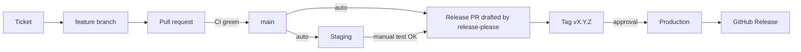

# Release process

How a change travels from an idea to production, and how to undo it.
Why it works this way: [ADR 0009](decisions/0009-branching-and-releases.md).



## 1. Plan

- Each version (v0.2, v0.3, …) is a GitHub **milestone**.
- Each step is a GitHub **issue** with goal, tasks and acceptance criteria, labelled
  `type: feature | chore | test | ci | docs | bug`.

## 2. Develop

```bash
git switch main && git pull
git switch -c feature/v0.2-blog
```

- Commit with [Conventional Commits](https://www.conventionalcommits.org/): `feat:`, `fix:`,
  `chore:`, `docs:`, `test:`, `ci:`, `refactor:`. Breaking changes: `feat!:`.
- Reference the ticket in the commit body: `Closes #12`. The issue closes when the commit reaches `main`.
- New features start **behind a feature flag** (off in staging and production).
- Before pushing: `npm run check` (the same checks CI runs).

## 3. Pull request

- Title in Conventional Commits form (checked by CI from step 12): `feat: add blog post pages`.
- CI must pass: lint, format, type check, unit tests, build (later: e2e tests).
- Merge with **Rebase and merge**, so `main` stays linear and every conventional commit is kept
  (the changelog is built from them).

## 4. Staging (automatic)

Every push to `main` runs `deploy-staging.yml`:

1. Build with `CLOUDFLARE_ENV=staging`
2. Run database migrations on the **staging** database (from v0.3)
3. Deploy the `prepnest-staging` Worker
4. Smoke test: `GET /api/health` must return `{"status":"ok","env":"staging"}`

Then test the version's checklist manually on the staging URL. Turn the new feature's flag on for
`staging` if it isn't yet.

## 5. Release to production

1. **Release PR**: release-please keeps one open, titled `chore(release): vX.Y.Z`
   ([ADR 0011](decisions/0011-release-please-drafts-releases.md)). On every push to `main` it
   recalculates the version and the new `CHANGELOG.md` section from the commits since the last tag.
   - Review the CHANGELOG lines; edit them in the PR if needed, **just before merging** (the next
     push to `main` regenerates the PR).
   - If this release ships a feature, turn its flag on for `production` in a separate
     `feat: release <feature>` PR first, so the release PR includes it.
2. Merge it (CI green; staging redeploys with the final code).
3. **Tag** the merge commit on `main`:
   ```bash
   git switch main && git pull
   git tag -a vX.Y.Z -m "vX.Y.Z"
   git push origin vX.Y.Z
   ```
4. `deploy-production.yml` starts and **waits for approval** (GitHub → Actions → the run →
   **Review deployments** → `production` → **Approve and deploy**).
5. After approval: migrations on the **production** database → deploy `prepnest-production` →
   smoke test → **GitHub Release** created with the CHANGELOG notes → the release PR is labelled
   `autorelease: tagged`, so release-please starts drafting the next one.

A release can still be prepared by hand (branch `release/vX.Y.Z`, `npm version X.Y.Z
--no-git-tag-version`, CHANGELOG section, commit `chore(release): vX.Y.Z`), e.g. if release-please
is broken. The production workflow accepts both.

### Release PR token

release-please needs a token whose pull requests trigger CI (the default `GITHUB_TOKEN` doesn't).

1. GitHub → **Settings** → **Developer settings** → **Personal access tokens** →
   **Fine-grained tokens** → **Generate new token**.
2. Name `PrepNest release-please`, expiry **1 year**, repository access **Only select
   repositories** → `PrepNest`.
3. Repository permissions: **Contents** read and write, **Pull requests** read and write,
   **Issues** read and write (labels). Metadata read-only is added automatically.
4. Store it as a repository secret (hidden prompt, never paste it anywhere else):
   `gh secret set RELEASE_PLEASE_TOKEN`
5. Put a reminder in your calendar for the expiry date. When it expires, the "Release PR" workflow
   fails; generate a new token and repeat step 4.

### Versioning (SemVer)

| Change                               | Before 1.0      | After 1.0      |
| ------------------------------------ | --------------- | -------------- |
| A planned version (v0.2 blog, …)     | `0.Y.0` (minor) | minor or major |
| A fix to a released version          | `0.Y.Z` (patch) | patch          |
| Breaking change for users or the API | minor           | major          |

### CHANGELOG

From v0.3.0, release-please writes each section from commit messages: `feat` → **Added**,
`fix` → **Fixed**, `perf` → **Performance**, `revert` → **Reverted**. `docs`, `chore`, `ci`,
`test`, `refactor` and `build` commits are left out. So write commit subjects for readers:
`feat: sign in with Google`, not `feat: auth stuff`. Sections up to v0.2.1 were written by hand in
[Keep a Changelog](https://keepachangelog.com/) style.

## 6. Rollback

Use the lightest option that fixes the problem:

| Situation                   | Action                                                                | Time    |
| --------------------------- | --------------------------------------------------------------------- | ------- |
| A new feature misbehaves    | Set its flag to `false` for production → PR → release a patch         | ~10 min |
| The whole release is broken | Re-run `deploy-production.yml` for the **previous tag** (manual run)  | ~5 min  |
| Emergency, CI unavailable   | `npx wrangler rollback --name prepnest-production` (previous version) | ~1 min  |

**Never roll back a database migration in production.** Migrations are written so the previous
release still works against the new schema (see below), so code can roll back on its own.

### Redeploy the previous tag (step by step)

1. GitHub → **Actions** → **Deploy production** → **Run workflow**.
2. **Use workflow from** → **Tags** → choose the previous good tag (e.g. `v0.1.0`).
3. **Run workflow** → open the run → **Review deployments** → `production` → **Approve and deploy**.
4. The smoke test checks that production reports the **old** version. No new GitHub Release is created.
5. Fix forward on a `fix/` branch, then release a patch.

### Emergency rollback without CI

```bash
npx wrangler deployments list --name prepnest-production   # find the previous version
npx wrangler rollback --name prepnest-production            # roll back to it
npm run smoke -- --url https://prepnest-production.prepnest.workers.dev --env production --version <old-version>
```

## 7. Hotfix

```bash
git switch main && git pull
git switch -c fix/quiz-timer-negative
# fix + test, commit "fix: stop quiz timer below zero" with "Closes #NN"
```

PR → merge → staging check → release PR for the patch version (`vX.Y.Z+1`) → tag → approve.

## 8. Safe database migrations (expand, then contract)

From v0.3 every schema change must keep the **previous release** working:

| Goal            | Release N (expand)                          | Release N+1 (contract)                 |
| --------------- | ------------------------------------------- | -------------------------------------- |
| Add a column    | Add it as nullable or with a default        | Make it required, if needed            |
| Rename a column | Add the new column, write to both, backfill | Stop reading the old one, then drop it |
| Remove a column | Stop using it in code                       | Drop it                                |

Migrations run on staging first (every merge), then production (every tag).

## Checklists

**Before tagging**

- [ ] Staging smoke test passed and the version's manual checklist is done on staging
- [ ] Release PR reviewed: version and CHANGELOG lines make sense
- [ ] Feature flags for this release set for production
- [ ] Migrations are backward-compatible

**After deploying**

- [ ] `GET /api/health` on production shows the new `version`
- [ ] Key pages load on a phone
- [ ] GitHub Release published; milestone closed
